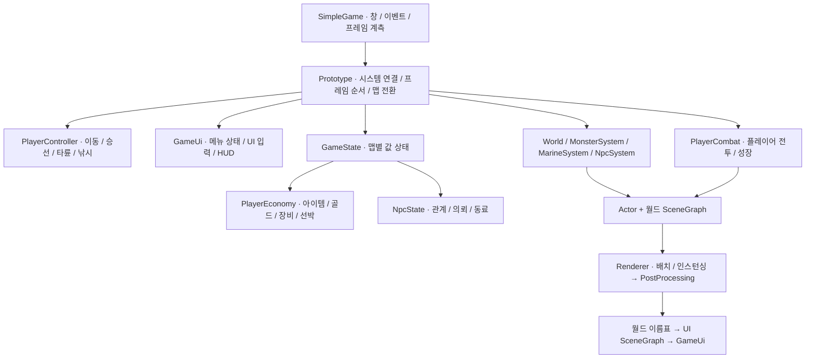
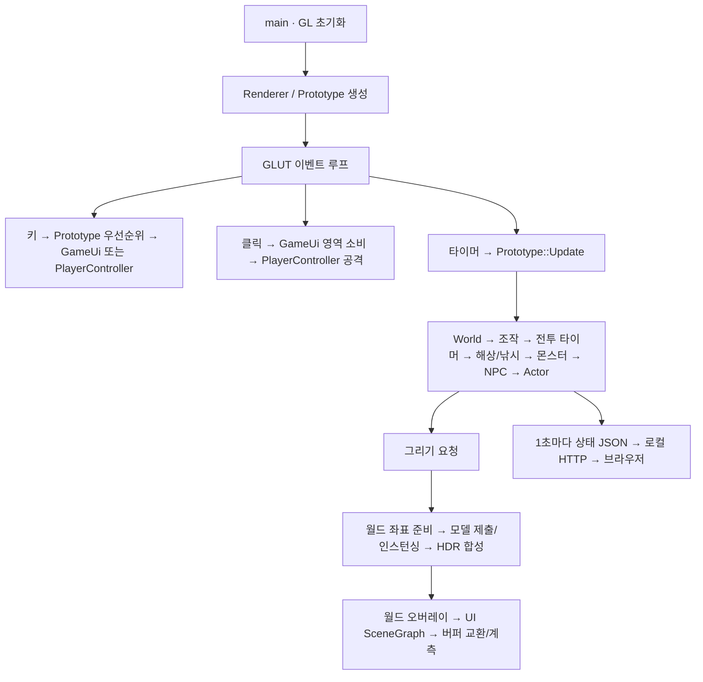

# 코드 구조와 파일별 역할

기준일은 2026-11-21이다. 자체 소스 **59개**, 헤더 **49개**, 셰이더 7개이며 Dependencies와 빌드 산출물은 제외했다. 별도 회귀 검사 소스는 Tests/GameplayRegression.cpp다.

## 전체 연결

이는 기능 연결도다. Prototype이 보유한 GameState의 economy/npcs를 각 서비스가 참조하며, NpcSystem은 NpcState를 소유하지 않는다. UI와 조작 객체는 Prototype의 private 멤버에 직접 접근하는 friend 방식으로 구현하지 않았다.

Prototype*.cpp는 현재 3개이며 같은 Prototype 클래스다. GameUi*.cpp는 같은 GameUi 클래스의 기능별 구현이고, InventoryEquipment.cpp는 PlayerEconomy의 구현이다. 파일 분할과 클래스 책임 분리를 구분한다.

## 실행 흐름

타이머는 16ms를 요청하며 고정 60 FPS를 보장하지 않는다. 몬스터·바닥 드랍 등은 System이 직접 Tick하고, 일부 효과·날씨는 SceneGraph의 Actor::Update를 사용한다. enabled=false와 visible=false의 의미는 다르다.

## 상태 보관과 전환

| 상태 | 담당 |
|---|---|
| 키·플레이 모드·갑판 위치·방향·낚시 | PlayerController |
| 현재 열린 창·선택 품목·HUD·후처리 옵션 | GameUi |
| HP·경험치·레벨·강화·전투 타이머 | PlayerCombat |
| 가방·장비·골드·소유 선박·적재품 | GameState.economy / PlayerEconomy |
| 의뢰·관계·기억·동료 명단 | GameState.npcs / NpcState |
| 로딩된 섬·청크·생성 대기열 | World |
| 몬스터·NPC·해상 오브젝트 수명/표시 | 각 System과 SceneGraph |

T 전환 때 GameState와 PlayerCombat::ProgressState, PlayerControlState 및 위치/카메라를 저장한다. 월드 청크와 각 맵의 System 객체를 교체한 뒤 같은 CreateMapSystems 연결 함수를 사용한다. 참조 대상인 GameState 객체 자체는 유지하고 값을 대입하므로 분리된 상태도 함께 복원된다.

이는 실행 중 메모리 스냅샷이다. MapState는 섬 방문 여부만 디스크에 저장하며, MeshCache 파일은 모델 캐시다. 전체 플레이어 영구 세이브 기능과 구분한다.

## 파일별 안내

같은 이름의 헤더가 있으면 함께 연결했다.

| 파일 | 쓰임새 |
|---|---|
| [Actor.cpp](C:/Users/Leejaehoon/Documents/GitHub/GSE/BaseProject_SE/SimpleGame/Actor.cpp) · [Actor.h](C:/Users/Leejaehoon/Documents/GitHub/GSE/BaseProject_SE/SimpleGame/Actor.h) | 기본 Actor, 변환 합성, MeshActor/ScaledMeshActor/CallbackActor 동작. |
| [CombatEffects.cpp](C:/Users/Leejaehoon/Documents/GitHub/GSE/BaseProject_SE/SimpleGame/CombatEffects.cpp) · [CombatEffects.h](C:/Users/Leejaehoon/Documents/GitHub/GSE/BaseProject_SE/SimpleGame/CombatEffects.h) | 현재 사용하는 SlashActor·DamageNumberActor. 이전 EnemyActor/DropActor 구현은 제거됨. |
| [CombatMeshes.cpp](C:/Users/Leejaehoon/Documents/GitHub/GSE/BaseProject_SE/SimpleGame/CombatMeshes.cpp) · [CombatMeshes.h](C:/Users/Leejaehoon/Documents/GitHub/GSE/BaseProject_SE/SimpleGame/CombatMeshes.h) | 현재 육상 슬래시 하나를 파일/메모리 캐시에 준비. 이전 모델 10종 생성 제거. |
| [Diagnostics.cpp](C:/Users/Leejaehoon/Documents/GitHub/GSE/BaseProject_SE/SimpleGame/Diagnostics.cpp) · [Diagnostics.h](C:/Users/Leejaehoon/Documents/GitHub/GSE/BaseProject_SE/SimpleGame/Diagnostics.h) | 실행파일 옆 로그 세션·events.log/CSV 스트림과 캐시 누적 정보. |
| [FrameProfiler.cpp](C:/Users/Leejaehoon/Documents/GitHub/GSE/BaseProject_SE/SimpleGame/FrameProfiler.cpp) · [FrameProfiler.h](C:/Users/Leejaehoon/Documents/GitHub/GSE/BaseProject_SE/SimpleGame/FrameProfiler.h) | 완료 프레임/FPS·Draw Call·CPU update/render/swap·업로드·캐시 통계 기록. |
| [GameUi.cpp](C:/Users/Leejaehoon/Documents/GitHub/GSE/BaseProject_SE/SimpleGame/GameUi.cpp) · [GameUi.h](C:/Users/Leejaehoon/Documents/GitHub/GSE/BaseProject_SE/SimpleGame/GameUi.h) | UI 바인딩, 입력 우선순위·모달 창 관리·후처리 표시 설정과 공통 HUD 클릭 소비. |
| [GameUiCargo.cpp](C:/Users/Leejaehoon/Documents/GitHub/GSE/BaseProject_SE/SimpleGame/GameUiCargo.cpp) | 선박 적재창 열기·닫기·품목 선택·적재/하역. |
| [GameUiHud.cpp](C:/Users/Leejaehoon/Documents/GitHub/GSE/BaseProject_SE/SimpleGame/GameUiHud.cpp) | 레벨·체력·경험치·골드, 원형 주변 해도, 육상 상호작용과 공격 경고, 메뉴 바로가기. |
| [GameUiPages.cpp](C:/Users/Leejaehoon/Documents/GitHub/GSE/BaseProject_SE/SimpleGame/GameUiPages.cpp) | 의뢰 일지, 전체 해도, 일시정지와 조작 안내, 테스트 맵 개발 도구. |
| [GameUiInventory.cpp](C:/Users/Leejaehoon/Documents/GitHub/GSE/BaseProject_SE/SimpleGame/GameUiInventory.cpp) | 4×4 가방 페이지와 장비 슬롯 배치, 클릭/키 선택·착용·해제·동료 해제. |
| [GameUiNpc.cpp](C:/Users/Leejaehoon/Documents/GitHub/GSE/BaseProject_SE/SimpleGame/GameUiNpc.cpp) | NPC 대화창과 수락·완료·영입·해제 입력. 상태 변경은 NpcState에 요청. |
| [GameUiPlayerHud.cpp](C:/Users/Leejaehoon/Documents/GitHub/GSE/BaseProject_SE/SimpleGame/GameUiPlayerHud.cpp) | 적재창 표시, 선박 체력·갑판 활동·해상 사건 안내. |
| [GameUiServices.cpp](C:/Users/Leejaehoon/Documents/GitHub/GSE/BaseProject_SE/SimpleGame/GameUiServices.cpp) | 상점/조선소 메뉴, 선박 구매·정박 확인. 산호 단축키도 일반 아이템 API 사용. |
| [GameUiTrade.cpp](C:/Users/Leejaehoon/Documents/GitHub/GSE/BaseProject_SE/SimpleGame/GameUiTrade.cpp) | 상점 구매/판매 입력·표시. 가격은 TradeRules, 소유 상태는 PlayerEconomy, 관계는 NpcState. |
| [InventoryEquipment.cpp](C:/Users/Leejaehoon/Documents/GitHub/GSE/BaseProject_SE/SimpleGame/InventoryEquipment.cpp) | 아이템 한 개 구매/판매, 장비 교환·해제, 공격/방어/최대 체력 합산. |
| [InventoryIcons.cpp](C:/Users/Leejaehoon/Documents/GitHub/GSE/BaseProject_SE/SimpleGame/InventoryIcons.cpp) · [InventoryIcons.h](C:/Users/Leejaehoon/Documents/GitHub/GSE/BaseProject_SE/SimpleGame/InventoryIcons.h) | 인벤토리 아이콘 9종의 CPU 단위 메시 생성/보관. 데이터 카탈로그 헤더와 분리. |
| [IslandLayout.cpp](C:/Users/Leejaehoon/Documents/GitHub/GSE/BaseProject_SE/SimpleGame/IslandLayout.cpp) · [IslandLayout.h](C:/Users/Leejaehoon/Documents/GitHub/GSE/BaseProject_SE/SimpleGame/IslandLayout.h) | 섬 형태 생성, 해안선·마을·건물·길·부두의 공통 격자와 경로장/지형 메시. |
| [IslandTerrainAdapter.cpp](C:/Users/Leejaehoon/Documents/GitHub/GSE/BaseProject_SE/SimpleGame/IslandTerrainAdapter.cpp) · [IslandTerrainAdapter.h](C:/Users/Leejaehoon/Documents/GitHub/GSE/BaseProject_SE/SimpleGame/IslandTerrainAdapter.h) | 시작 섬 미니맵과 마커 표시. 이전 전투/경로 어댑터의 미사용 API·초기 BFS 제거. |
| [IslandTestMap.cpp](C:/Users/Leejaehoon/Documents/GitHub/GSE/BaseProject_SE/SimpleGame/IslandTestMap.cpp) · [IslandTestMap.h](C:/Users/Leejaehoon/Documents/GitHub/GSE/BaseProject_SE/SimpleGame/IslandTestMap.h) | 2행×4열 8종 테스트 섬의 규격·중심점·청크 대응. |
| [ItemCatalog.cpp](C:/Users/Leejaehoon/Documents/GitHub/GSE/BaseProject_SE/SimpleGame/ItemCatalog.cpp) · [ItemCatalog.h](C:/Users/Leejaehoon/Documents/GitHub/GSE/BaseProject_SE/SimpleGame/ItemCatalog.h) | 86종 아이템 이름·기준가·중첩·장비 능력치와 몬스터 드랍 정의. |
| [MapCatalog.cpp](C:/Users/Leejaehoon/Documents/GitHub/GSE/BaseProject_SE/SimpleGame/MapCatalog.cpp) · [MapCatalog.h](C:/Users/Leejaehoon/Documents/GitHub/GSE/BaseProject_SE/SimpleGame/MapCatalog.h) | 8종 섬 비중·특산품 배정과 32종 상품 이름. 미사용 거래 정책/Offers 경로 제거. |
| [MapState.cpp](C:/Users/Leejaehoon/Documents/GitHub/GSE/BaseProject_SE/SimpleGame/MapState.cpp) · [MapState.h](C:/Users/Leejaehoon/Documents/GitHub/GSE/BaseProject_SE/SimpleGame/MapState.h) | 섬 방문 여부 파일 저장/로드. 전체 플레이어 세이브는 아님. |
| [MarineActors.cpp](C:/Users/Leejaehoon/Documents/GitHub/GSE/BaseProject_SE/SimpleGame/MarineActors.cpp) · [MarineActors.h](C:/Users/Leejaehoon/Documents/GitHub/GSE/BaseProject_SE/SimpleGame/MarineActors.h) | 해적선·촉수·승선 해적·토네이도 표시, 비·번개·천둥 Actor. |
| [MarineMeshes.cpp](C:/Users/Leejaehoon/Documents/GitHub/GSE/BaseProject_SE/SimpleGame/MarineMeshes.cpp) | 해적선·촉수·토네이도·해적·칼·상자 공유 외형. 구조체 선언은 MarineSystem.h. |
| [MarineSystem.cpp](C:/Users/Leejaehoon/Documents/GitHub/GSE/BaseProject_SE/SimpleGame/MarineSystem.cpp) · [MarineSystem.h](C:/Users/Leejaehoon/Documents/GitHub/GSE/BaseProject_SE/SimpleGame/MarineSystem.h) | 해상 조우·선박 체력·크라켄·토네이도·탈출·날씨 밝기와 해적 시스템 연결. |
| [MeshCache.cpp](C:/Users/Leejaehoon/Documents/GitHub/GSE/BaseProject_SE/SimpleGame/MeshCache.cpp) · [MeshCache.h](C:/Users/Leejaehoon/Documents/GitHub/GSE/BaseProject_SE/SimpleGame/MeshCache.h) | 반복 자산 키를 메모리 → .mesh 파일 → 생성 함수 순으로 준비/공유. |
| [MonitorServer.cpp](C:/Users/Leejaehoon/Documents/GitHub/GSE/BaseProject_SE/SimpleGame/MonitorServer.cpp) · [MonitorServer.h](C:/Users/Leejaehoon/Documents/GitHub/GSE/BaseProject_SE/SimpleGame/MonitorServer.h) | 로컬 HTTP에서 모니터 HTML과 최신 JSON을 제공한다. |
| [MonitorSnapshot.cpp](C:/Users/Leejaehoon/Documents/GitHub/GSE/BaseProject_SE/SimpleGame/MonitorSnapshot.cpp) | Prototype의 현재 섬·몹·NPC 상태를 읽어 JSON 한 건으로 변환한다. |
| [MonsterActor.cpp](C:/Users/Leejaehoon/Documents/GitHub/GSE/BaseProject_SE/SimpleGame/MonsterActor.cpp) · [MonsterActor.h](C:/Users/Leejaehoon/Documents/GitHub/GSE/BaseProject_SE/SimpleGame/MonsterActor.h) | 몬스터 한 마리의 추적·공격 예고·피격·복귀·리스폰·표시와 몬스터용 경로 접근. |
| [MonsterCatalog.cpp](C:/Users/Leejaehoon/Documents/GitHub/GSE/BaseProject_SE/SimpleGame/MonsterCatalog.cpp) · [MonsterCatalog.h](C:/Users/Leejaehoon/Documents/GitHub/GSE/BaseProject_SE/SimpleGame/MonsterCatalog.h) | 40종 몬스터 정의 및 섬별 종 매핑·임시 전투 수치. |
| [MonsterItemDrop.cpp](C:/Users/Leejaehoon/Documents/GitHub/GSE/BaseProject_SE/SimpleGame/MonsterItemDrop.cpp) · [MonsterItemDrop.h](C:/Users/Leejaehoon/Documents/GitHub/GSE/BaseProject_SE/SimpleGame/MonsterItemDrop.h) | 바닥 아이템 한 개의 자석 이동·자동 습득·수명·외형. |
| [MonsterMeshes.cpp](C:/Users/Leejaehoon/Documents/GitHub/GSE/BaseProject_SE/SimpleGame/MonsterMeshes.cpp) · [MonsterMeshes.h](C:/Users/Leejaehoon/Documents/GitHub/GSE/BaseProject_SE/SimpleGame/MonsterMeshes.h) | 몬스터 형태별 공유 모델/공격 예고/에픽 링. 선언은 독립 MonsterMeshes.h. |
| [MonsterSystem.cpp](C:/Users/Leejaehoon/Documents/GitHub/GSE/BaseProject_SE/SimpleGame/MonsterSystem.cpp) · [MonsterSystem.h](C:/Users/Leejaehoon/Documents/GitHub/GSE/BaseProject_SE/SimpleGame/MonsterSystem.h) | 섬별 일반/에픽 배치, 활성 범위·경로장·갱신 주기, 명중과 드랍/습득 콜백. |
| [NpcDialogue.cpp](C:/Users/Leejaehoon/Documents/GitHub/GSE/BaseProject_SE/SimpleGame/NpcDialogue.cpp) · [NpcDialogue.h](C:/Users/Leejaehoon/Documents/GitHub/GSE/BaseProject_SE/SimpleGame/NpcDialogue.h) | 한국어 기본 대사와 선택적 비동기 대화 제공자. 실제 외부 AI 서비스는 미연결. |
| [NpcState.cpp](C:/Users/Leejaehoon/Documents/GitHub/GSE/BaseProject_SE/SimpleGame/NpcState.cpp) · [NpcState.h](C:/Users/Leejaehoon/Documents/GitHub/GSE/BaseProject_SE/SimpleGame/NpcState.h) | NPC 호감도·기억·의뢰 상태·진행·동료 명단. 전달 의뢰 때만 인벤토리를 명시적으로 전달받음. |
| [NpcSystem.cpp](C:/Users/Leejaehoon/Documents/GitHub/GSE/BaseProject_SE/SimpleGame/NpcSystem.cpp) · [NpcSystem.h](C:/Users/Leejaehoon/Documents/GitHub/GSE/BaseProject_SE/SimpleGame/NpcSystem.h) | 로딩된 섬의 NPC Actor 배치·수명·이름표, 동료 추적/승선, 근처 NPC 선택과 대화 사실 구성. |
| [PirateRaid.cpp](C:/Users/Leejaehoon/Documents/GitHub/GSE/BaseProject_SE/SimpleGame/PirateRaid.cpp) · [PirateRaid.h](C:/Users/Leejaehoon/Documents/GitHub/GSE/BaseProject_SE/SimpleGame/PirateRaid.h) | 해적 접현·승선 전투·40초 약탈/복귀·실패와 선박 간 충돌. |
| [PlayerCombat.cpp](C:/Users/Leejaehoon/Documents/GitHub/GSE/BaseProject_SE/SimpleGame/PlayerCombat.cpp) · [PlayerCombat.h](C:/Users/Leejaehoon/Documents/GitHub/GSE/BaseProject_SE/SimpleGame/PlayerCombat.h) | 플레이어 HP·경험치·레벨·공통 강화·피격·회복·사망. 효과 위치를 WorldPosition으로 보관. |
| [PlayerCombatState.cpp](C:/Users/Leejaehoon/Documents/GitHub/GSE/BaseProject_SE/SimpleGame/PlayerCombatState.cpp) | 전투/성장 Snapshot·Restore와 전환 시 효과 정리. 파일 세이브 기능은 아님. |
| [PlayerController.cpp](C:/Users/Leejaehoon/Documents/GitHub/GSE/BaseProject_SE/SimpleGame/PlayerController.cpp) · [PlayerController.h](C:/Users/Leejaehoon/Documents/GitHub/GSE/BaseProject_SE/SimpleGame/PlayerController.h) | 키 상태, 육상·갑판·타륜 이동, 승선/하선·해적선 왕복, 공격 시작·낚시·조작 상태 스냅샷. |
| [PlayerEconomy.cpp](C:/Users/Leejaehoon/Documents/GitHub/GSE/BaseProject_SE/SimpleGame/PlayerEconomy.cpp) · [PlayerEconomy.h](C:/Users/Leejaehoon/Documents/GitHub/GSE/BaseProject_SE/SimpleGame/PlayerEconomy.h) | 골드·가방·선박 소유·적재품과 획득·적재/하역·해상 물건 손실. NPC 상태는 소유하지 않음. |
| [PostProcessing.cpp](C:/Users/Leejaehoon/Documents/GitHub/GSE/BaseProject_SE/SimpleGame/PostProcessing.cpp) · [PostProcessing.h](C:/Users/Leejaehoon/Documents/GitHub/GSE/BaseProject_SE/SimpleGame/PostProcessing.h) | HDR 타깃·MSAA resolve·블러·톤 매핑·비넷·외곽 블러 합성. |
| [Prototype.cpp](C:/Users/Leejaehoon/Documents/GitHub/GSE/BaseProject_SE/SimpleGame/Prototype.cpp) · [Prototype.h](C:/Users/Leejaehoon/Documents/GitHub/GSE/BaseProject_SE/SimpleGame/Prototype.h) | 전체 시스템 생성/연결을 한 곳에서 수행하고 프레임 갱신·렌더 순서를 조율. 입력은 담당 객체에 전달. |
| [PrototypeScene.cpp](C:/Users/Leejaehoon/Documents/GitHub/GSE/BaseProject_SE/SimpleGame/PrototypeScene.cpp) | 플레이어·배·장식·HUD Actor 생성과 외형/카메라 상대 배치 준비. |
| [PrototypeTestMap.cpp](C:/Users/Leejaehoon/Documents/GitHub/GSE/BaseProject_SE/SimpleGame/PrototypeTestMap.cpp) | T 왕복, F1~F8 이동, Y 전체/상세 보기와 맵별 GameState·전투·조작 상태 복원. |
| [QuestRules.cpp](C:/Users/Leejaehoon/Documents/GitHub/GSE/BaseProject_SE/SimpleGame/QuestRules.cpp) · [QuestRules.h](C:/Users/Leejaehoon/Documents/GitHub/GSE/BaseProject_SE/SimpleGame/QuestRules.h) | 역할별 의뢰 목표·보상·설명과 재료 계산/전달 공통 규칙. |
| [Renderer.cpp](C:/Users/Leejaehoon/Documents/GitHub/GSE/BaseProject_SE/SimpleGame/Renderer.cpp) · [Renderer.h](C:/Users/Leejaehoon/Documents/GitHub/GSE/BaseProject_SE/SimpleGame/Renderer.h) | GL 자원·셰이더 로딩, 공유 정점별 인스턴싱/GPU 캐시, 한국어 글꼴·패널·화면 출력. |
| [RendererIcon.cpp](C:/Users/Leejaehoon/Documents/GitHub/GSE/BaseProject_SE/SimpleGame/RendererIcon.cpp) | CPU 단위 아이콘을 화면 위치로 변환해 기존 UI 스트림에 추가. |
| [SceneGraph.cpp](C:/Users/Leejaehoon/Documents/GitHub/GSE/BaseProject_SE/SimpleGame/SceneGraph.cpp) · [SceneGraph.h](C:/Users/Leejaehoon/Documents/GitHub/GSE/BaseProject_SE/SimpleGame/SceneGraph.h) | Actor 수명·부모/자식·조회·지연 삭제·Update/Render/Overlay 순회. |
| [ShipDeck.cpp](C:/Users/Leejaehoon/Documents/GitHub/GSE/BaseProject_SE/SimpleGame/ShipDeck.cpp) · [ShipDeck.h](C:/Users/Leejaehoon/Documents/GitHub/GSE/BaseProject_SE/SimpleGame/ShipDeck.h) | 내 배/해적선 갑판 모양·장애물·걷기·승선 지점·타륜과 로컬 좌표 변환/추적. |
| [SimpleGame.cpp](C:/Users/Leejaehoon/Documents/GitHub/GSE/BaseProject_SE/SimpleGame/SimpleGame.cpp) | 프로그램 시작, GLUT/OpenGL 초기화, 키·마우스·타이머·그리기 콜백과 성능 측정 연결. |
| [TownServiceActor.cpp](C:/Users/Leejaehoon/Documents/GitHub/GSE/BaseProject_SE/SimpleGame/TownServiceActor.cpp) · [TownServiceActor.h](C:/Users/Leejaehoon/Documents/GitHub/GSE/BaseProject_SE/SimpleGame/TownServiceActor.h) | 상점/조선소 구역 모델과 이름표. |
| [TradeRules.cpp](C:/Users/Leejaehoon/Documents/GitHub/GSE/BaseProject_SE/SimpleGame/TradeRules.cpp) · [TradeRules.h](C:/Users/Leejaehoon/Documents/GitHub/GSE/BaseProject_SE/SimpleGame/TradeRules.h) | 지역/호감도 가격 산식. 현재 상점과 테스트가 사용하는 단일 견적 경로. |
| [World.cpp](C:/Users/Leejaehoon/Documents/GitHub/GSE/BaseProject_SE/SimpleGame/World.cpp) · [World.h](C:/Users/Leejaehoon/Documents/GitHub/GSE/BaseProject_SE/SimpleGame/World.h) | 청크 생성 대기열·로딩/해제, 보행·항해 충돌, 마을 시설, 지도·방문 기록 연결. |
| [WorldActors.cpp](C:/Users/Leejaehoon/Documents/GitHub/GSE/BaseProject_SE/SimpleGame/WorldActors.cpp) · [WorldActors.h](C:/Users/Leejaehoon/Documents/GitHub/GSE/BaseProject_SE/SimpleGame/WorldActors.h) | 카메라 상대 WorldActor, 바다·파도·격자·깃발·갈매기 Actor와 외형/애니메이션. |
| [WorldPosition.cpp](C:/Users/Leejaehoon/Documents/GitHub/GSE/BaseProject_SE/SimpleGame/WorldPosition.cpp) · [WorldPosition.h](C:/Users/Leejaehoon/Documents/GitHub/GSE/BaseProject_SE/SimpleGame/WorldPosition.h) | 64비트 청크 번호와 청크 내부 double 좌표, 가까운 기준점에 대한 상대 Vec3 변환. |
| [WorldTestMap.cpp](C:/Users/Leejaehoon/Documents/GitHub/GSE/BaseProject_SE/SimpleGame/WorldTestMap.cpp) | 일반/테스트 맵의 청크·섬 루트·대기열 교환과 이동 직후 주변 준비. |
| [stdafx.cpp](C:/Users/Leejaehoon/Documents/GitHub/GSE/BaseProject_SE/SimpleGame/stdafx.cpp) · [stdafx.h](C:/Users/Leejaehoon/Documents/GitHub/GSE/BaseProject_SE/SimpleGame/stdafx.h) | MSVC 미리 컴파일된 헤더 생성용 소스. |

## 단독 헤더

| 파일 | 쓰임새 |
|---|---|
| [GameState.h](C:/Users/Leejaehoon/Documents/GitHub/GSE/BaseProject_SE/SimpleGame/GameState.h) | 플레이어 경제와 NPC 상태를 묶는 값 객체. 맵별 스냅샷에서 함께 복사한다. |
| [GeometryTypes.h](C:/Users/Leejaehoon/Documents/GitHub/GSE/BaseProject_SE/SimpleGame/GeometryTypes.h) | Vec2/Vec3/Color/Vertex/Mesh 공통 타입. OpenGL 헤더를 포함하지 않는다. |
| [IslandKey.h](C:/Users/Leejaehoon/Documents/GitHub/GSE/BaseProject_SE/SimpleGame/IslandKey.h) | 섬 식별자와 비교 연산. 지형 구현에 의존하지 않는다. |
| [KoreanText.h](C:/Users/Leejaehoon/Documents/GitHub/GSE/BaseProject_SE/SimpleGame/KoreanText.h) | 한국어 공용 HUD·조작 안내·환영 문구. |
| [NpcData.h](C:/Users/Leejaehoon/Documents/GitHub/GSE/BaseProject_SE/SimpleGame/NpcData.h) | NPC 식별자·명명된 역할 상수·의뢰 상태·관계/기억 레코드. |
| [RenderStatistics.h](C:/Users/Leejaehoon/Documents/GitHub/GSE/BaseProject_SE/SimpleGame/RenderStatistics.h) | 실제 glDraw 호출을 계수하는 프레임 통계 구조. |
| [UiLayout.h](C:/Users/Leejaehoon/Documents/GitHub/GSE/BaseProject_SE/SimpleGame/UiLayout.h) · [UiLayout.cpp](C:/Users/Leejaehoon/Documents/GitHub/GSE/BaseProject_SE/SimpleGame/UiLayout.cpp) | 화면 크기 스케일, 패널 9분할, 공통 버튼과 글자. 화면 그리기와 클릭 처리가 같은 레이아웃을 사용한다. |
| [targetver.h](C:/Users/Leejaehoon/Documents/GitHub/GSE/BaseProject_SE/SimpleGame/targetver.h) | Windows SDK 대상 설정. |

## 수정 목적별 첫 파일

| 수정할 내용 | 먼저 볼 곳 |
|---|---|
| 전역 키 우선순위·갱신 순서 | Prototype.cpp |
| 이동·승선·타륜·낚시 | PlayerController.cpp |
| HP·공격·경험치·강화 | PlayerCombat.cpp |
| HUD 위치·클릭 차단 | UiLayout.h, GameUi.cpp, GameUiHud.cpp |
| 인벤토리 창·장비 클릭 | GameUiInventory.cpp |
| NPC 의뢰 목표·보상·안내 | QuestRules.cpp |
| NPC 의뢰 완료·관계·영입 | NpcState.cpp |
| 동료 이동·NPC 배치 | NpcSystem.cpp |
| 대사와 외부 AI 제공자 | NpcDialogue.cpp |
| 아이템·드랍률·장비 능력치 | ItemCatalog.cpp |
| 지역/호감도 가격 | TradeRules.cpp |
| 섬 모양·길·마을 배치 | IslandLayout.cpp |
| 청크 로딩·활성 영역 | World.cpp |
| 일반 몬스터 행동/출현 | MonsterActor.cpp / MonsterSystem.cpp |
| 해적 승선·약탈 | PirateRaid.cpp |
| 크라켄·토네이도 | MarineSystem.cpp |
| GPU 배치·업로드 | Renderer.cpp / MeshCache.cpp |

## 전투와 거래 연결 예

육상 공격: SimpleGame 입력 → Prototype의 UI 소비 확인 → PlayerController::Attack → PlayerCombat의 쿨다운·효과 → MonsterSystem의 명중/드랍 → 콜백으로 PlayerCombat 경험치 및 NpcState 의뢰 진행. 바닥 습득은 PlayerEconomy에 반영되고 GameUi가 표시한다.

거래: GameUiTrade 선택 → TradeRules 견적 → PlayerEconomy의 수량/골드 변경 → 성공 시 NpcState의 호감도·상인 의뢰 진행. 의뢰 완료와 표시 진행/목표는 QuestRules와 NpcState::Progress를 공유한다.

## 좌표·자산·그리기

- 전투 효과는 WorldPosition을 보관한다. 월드 원점을 기준으로 큰 float 좌표를 만든 뒤 상쇄하지 않고, 렌더 직전에 카메라와의 가까운 차이를 계산한다.
- IslandLayout은 렌더 지형과 보행·마을·경로 기준을 공유한다. 시작 섬 차트만 IslandTerrainAdapter를 사용하며 전투 코드는 여기에 의존하지 않는다.
- MeshCache는 CPU 정점과 파일 캐시, Renderer는 GPU 버퍼 캐시와 인스턴스 배치다. 같은 공유 정점 리소스를 제출한 Actor들이 묶인다. Actor 수와 Draw Call 수는 다르다.
- 아이콘은 기존 UI 스트림을 사용한다. HDR 후처리는 월드에 적용한 뒤 UI를 그린다.
- GeometryTypes/ItemCatalog/NpcData 등 데이터와 InventoryIcons/MonsterMeshes 등의 그리기 자원을 분리했다.

## 셰이더·프로젝트·로그

| 파일 | 역할 |
|---|---|
| [Shaders/World.vs](C:/Users/Leejaehoon/Documents/GitHub/GSE/BaseProject_SE/SimpleGame/Shaders/World.vs) / [Shaders/World.fs](C:/Users/Leejaehoon/Documents/GitHub/GSE/BaseProject_SE/SimpleGame/Shaders/World.fs) | 월드 인스턴스 투영·정점 애니메이션·색상/조명 |
| [Shaders/SolidRect.vs](C:/Users/Leejaehoon/Documents/GitHub/GSE/BaseProject_SE/SimpleGame/Shaders/SolidRect.vs) / [Shaders/SolidRect.fs](C:/Users/Leejaehoon/Documents/GitHub/GSE/BaseProject_SE/SimpleGame/Shaders/SolidRect.fs) | UI·글꼴 및 일부 동적 스트림 출력 |
| [Shaders/PostProcess.vs](C:/Users/Leejaehoon/Documents/GitHub/GSE/BaseProject_SE/SimpleGame/Shaders/PostProcess.vs) / [Shaders/PostProcess.fs](C:/Users/Leejaehoon/Documents/GitHub/GSE/BaseProject_SE/SimpleGame/Shaders/PostProcess.fs) | 전체 화면 삼각형과 톤 매핑·비넷·외곽 블러 합성 |
| [Shaders/Blur.fs](C:/Users/Leejaehoon/Documents/GitHub/GSE/BaseProject_SE/SimpleGame/Shaders/Blur.fs) | 블러 패스 |
| [Monitor/index.html](C:/Users/Leejaehoon/Documents/GitHub/GSE/BaseProject_SE/SimpleGame/Monitor/index.html) | 섬과 NPC의 JSON 상태를 주기적으로 읽어 표시하는 로컬 화면. [사용법과 JSON 형식](C:/Users/Leejaehoon/Documents/GitHub/GSE/BaseProject_SE/doc/WORLD_MONITOR.md) |
| [SimpleGame.vcxproj](C:/Users/Leejaehoon/Documents/GitHub/GSE/BaseProject_SE/SimpleGame/SimpleGame.vcxproj) / [SimpleGame.vcxproj.filters](C:/Users/Leejaehoon/Documents/GitHub/GSE/BaseProject_SE/SimpleGame/SimpleGame.vcxproj.filters) | 컴파일·링크·셰이더 및 모니터 HTML 복사와 VS 탐색기 분류 |

실행파일 옆 Logs/run_...에 events.log·summary.csv·batches.csv 및 선택적 frames.csv를 기록한다. FrameProfiler의 CPU 시간은 GPU 실행 시간 측정과 다르다.

외부 AI 서비스는 아직 미연결이며 기본 한국어 대사와 제공자 인터페이스를 유지한다. SceneGraph 전체 정리 횟수 등 성능 후보는 측정 전 일괄 변경하지 않았다.

리팩터링 변경점·미실행 회귀 검사·사용자 확인 순서는 [REFACTOR_REPORT_2026-10-29.md](C:/Users/Leejaehoon/Documents/GitHub/GSE/BaseProject_SE/doc/REFACTOR_REPORT_2026-10-29.md)에 기록한다.

